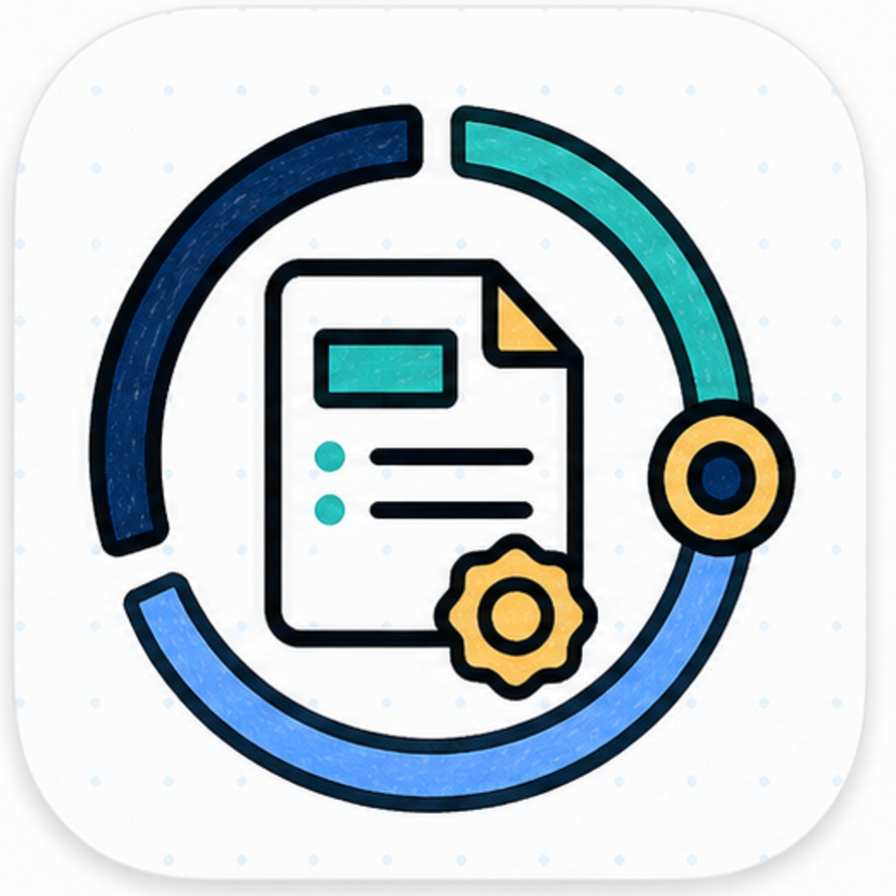
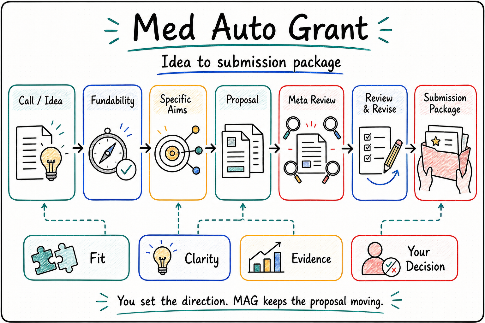

  

<strong>English</strong> | <a href="./README.zh-CN.md">中文</a>

<h1 align="center">Med Auto Grant</h1>

Med Auto Grant helps medical research teams turn a research idea, team track record, and preliminary evidence into a reviewable application for one funding call.

  

## Develop and review the same application

Starting from the call and your existing material, MAG brings the scientific question, the team’s evidence, and the proposed aims together so you can decide which direction to pursue. Once you choose a direction, drafts, independent critiques, and the reasons for revisions stay with the same application. When you return to revise a section, you can build on the aims and materials you already accepted.

The applicant decides the scientific direction, what to adopt from review, and when to submit. MAG applies those decisions, prepares the local materials, and shows which arguments are ready for review, which attachments are outstanding, and whether the submission package is assembled. External uploads and signatures require the applicant’s authorization.

## Start with a call or a draft

> “Use this funding call and our draft to check whether the aims fit the team’s existing evidence. Review the argument independently, then give me a revision we can discuss.”

## Get started

Install **Med Auto Grant** from the OPL Software Center. Open or start an application and share the call, the material you have, and what you want to resolve in this round. [Usage guide](docs/product.md) · [Current status](docs/status.md)

[Project scope](docs/project.md) · [Documentation](docs/README.md) · [Managing knowledge and sources](docs/references/grant_strategy_memory_policy.md)
