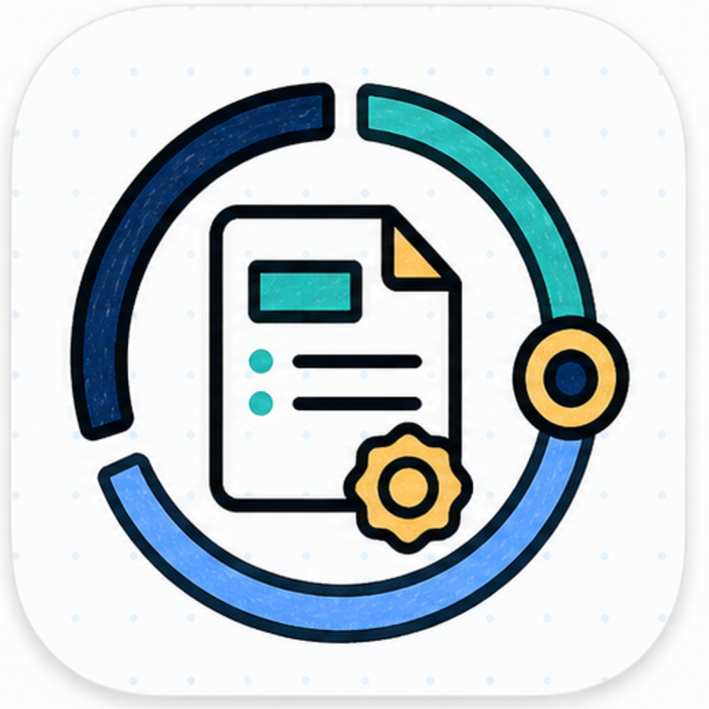
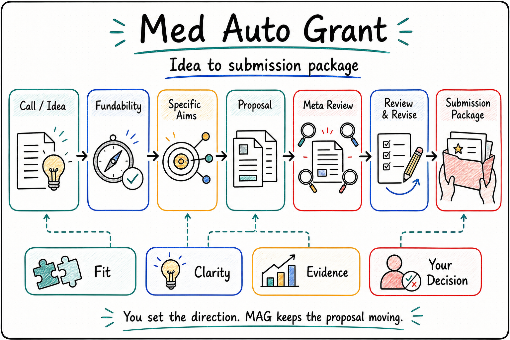

  

<a href="./README.md">English</a> | <strong>中文</strong>

<h1 align="center">Med Auto Grant</h1>

Med Auto Grant 帮医学研究团队围绕一份基金指南，把研究构想、团队基础和预实验资料做成可以评审的申请书。

  

## 围绕同一项申请反复打磨

从目标指南和已有材料起步，MAG 先把拟解决的科学问题、团队已有依据和研究目标摆在一起，帮你看清哪些方向值得继续。确定方向后，草稿、独立评审意见和修订依据都随同一项申请保留。回来补一段研究方法时，可以沿用已经确认的目标和材料。

申请人决定科学问题、论证取舍和最终提交。MAG 按这些决定修订并准备本地申请材料，让你看到哪些论证已可评审、哪些附件还要补，以及是否已形成完整提交包。对外上传和签署由申请人授权。

## 从一份指南或草稿开始

> “按这份国自然指南和现有草稿，帮我检查研究目标与团队基础是否匹配。先独立评审，再给我一版可以讨论的修订稿。”

## 开始使用

在 OPL 软件中心安装 **Med Auto Grant**。打开或新建一项申请，给出基金指南、已有材料和这轮想解决的问题。[使用入口](docs/product/README.md) · [当前状态](docs/status.md)

[项目范围](docs/project.md) · [文档索引](docs/README.md) · [知识与资料维护](docs/references/grant_strategy_memory_policy.md)
